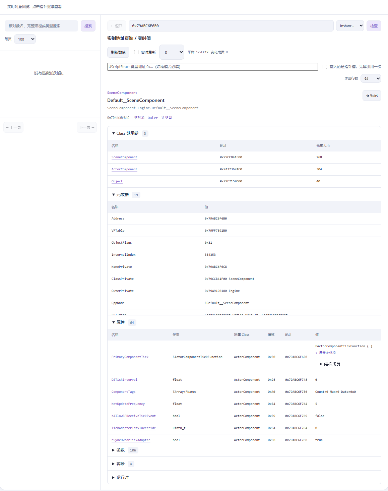
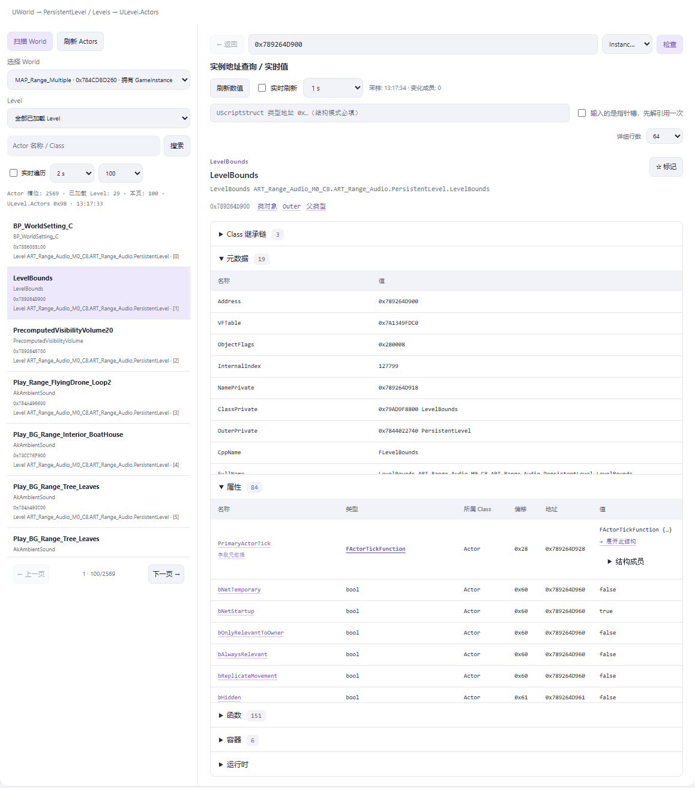
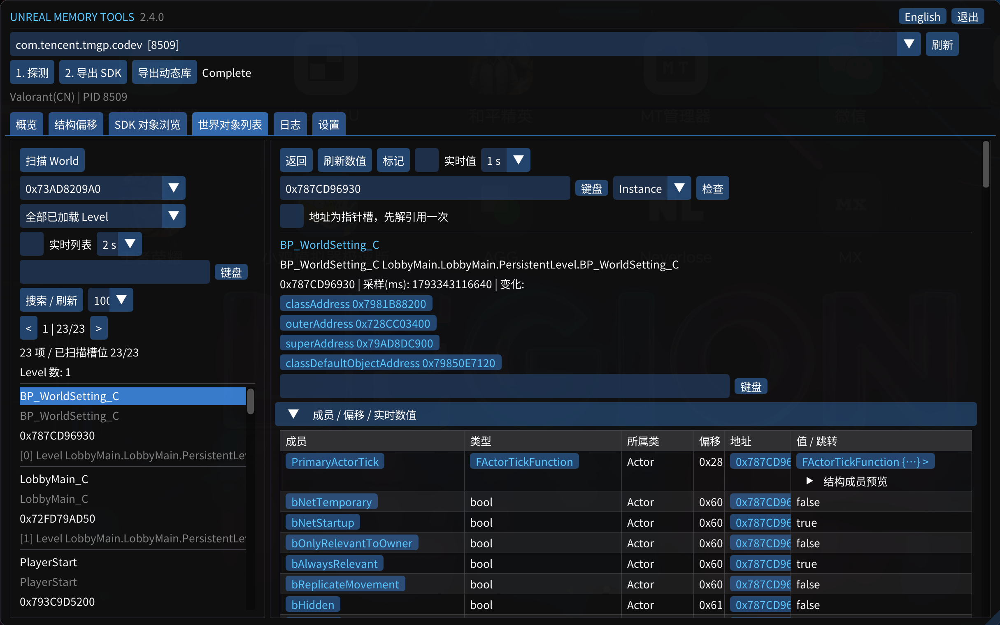
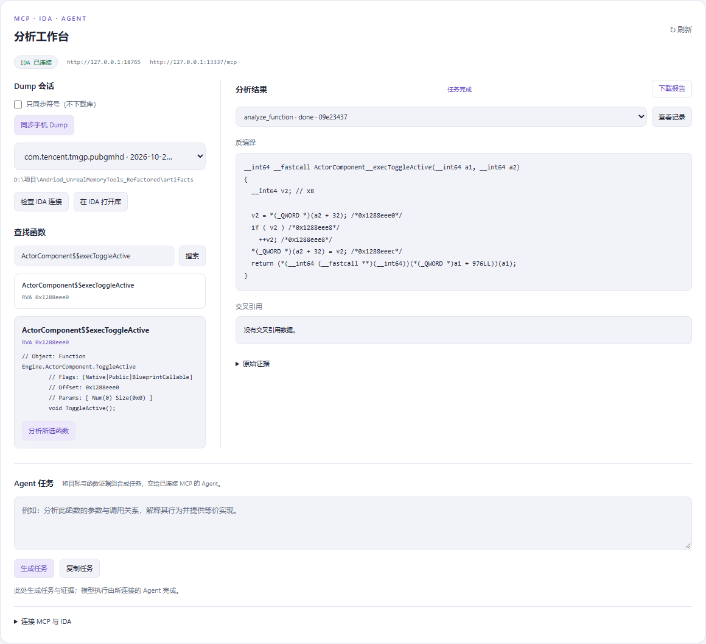

# UnrealMemoryTools

Android Unreal Engine Dumper with Vulkan / ImGui UI, a desktop Web workbench, live object inspection, and MCP + IDA integration.

> Author / 原作者：曦曦（DreamFekk）— https://github.com/DreamFekk  
> Author's notice / 作者倡议：No reselling for profit / 禁止圈钱盗卖  
> QQ Group / QQ 群：977186929  
> Refactored edition / 重构版：1.0.1 · Android ARM64 · Windows desktop

[English](#english) | [中文](#中文)

---

## English

### Overview

`UnrealMemoryTools` is an external Unreal Engine dumper for Android. It runs as an ARM64 ELF and reads target memory through `KittyMemoryEx`. Dumping does not require injecting a library into the target.

The refactored edition preserves dedicated game profiles, the generic `AutoFix` fallback and SDK output formats. It provides a native phone overlay, a computer / phone Web interface, a headless CLI, live instance and structure inspection, a `ULevel.Actors` browser, and an MCP / IDA analysis workbench.

**Basic dumping requires a rooted Android device, ADB and Python. IDA and an AI client are optional.** The phone program is an Android ELF, not an APK or Windows executable.

### Preview

Desktop instance inspector; the captured UI is Chinese, while the application supports Chinese / English switching.



Loaded-world Actor browser, tested on Valorant Mobile:



### Features

- **Probe → Export SDK → Export Library**, with progress, timings, logs and downloads.
- **Dedicated profiles + AutoFix fallback** when a matching profile cannot initialize.
- **Native, Web and CLI modes**: Vulkan / ImGui phone overlay, lightweight Web UI and headless operation.
- **Process isolation and task-scoped caches**, preventing names from leaking across targets.
- **SDK browser**: global object search, pagination, UObject / FField metadata, properties, functions and offsets.
- **Instance inspector**: class hierarchy, declaring class, member offsets, addresses, current values and inherited functions.
- **Type / pointer navigation**: click `Pawn / APawn*` to inspect the type; follow live pointers or expand embedded structures.
- **UE5 compatibility**: bounded UTF-16 / outline FNames, runtime layout isolation, tagged FField owners, Optional / ObjectPtr property types and dynamic split enum storage. See [validation scope](docs/ue5-profile-support.md).
- **FVector values**: display X / Y / Z using supported float32 / float64 layouts instead of hexadecimal words.
- **World objects**: traverse `PersistentLevel` and loaded `World.Levels` through `ULevel.Actors`.
- **Live sampling**: Actor lists at 1 / 2 / 5 seconds; instance values at 0.5 / 1 / 2 / 5 seconds, with change highlighting.
- **MCP + IDA**: 15 stdio tools for device operations, artifact sessions, symbol lookup, IDA analysis and Agent reports.
- **Release packaging**: user / source ZIPs, offline instructions, numbered launchers, manifests and SHA-256.

### Quick start

1. Extract the entire `windows-user.zip`.
2. Open `00-START-HERE.html`.
3. Install Python and Google Platform-Tools; enable USB debugging and grant shell Root access.
4. Run `01-CHECK-ENV.cmd`, then `02-START-DESKTOP.cmd`.
5. Start the game, select its process, and run **Probe → Export SDK → Export Library**.

From the source directory:

```powershell
python .\desktop\launcher.py
python .\desktop\launcher.py --no-deploy
python .\desktop\launcher.py --native
```

| Entry | Default address / location |
|---|---|
| Full desktop workbench | `http://127.0.0.1:18766` |
| Phone Web / ADB-forwarded device API | `http://127.0.0.1:18765` |
| IDA MCP supervisor | `http://127.0.0.1:13338/mcp` by default; the GUI plugin can remain on 13337 |
| Phone output | `/sdcard/UnrealMemoryTools_Refactored/<package>/` |
| Desktop sessions / reports | `artifacts/sessions/` / `artifacts/reports/` |

The phone Web page does not host the computer's IDA service. Native overlay and phone HTTP modes are mutually exclusive. Closing the browser does not stop background services.

### Output files

| File | Purpose |
|---|---|
| `Logs.txt` | SDK generation log and engine information |
| `Objects.txt` | Object indices, addresses and full names |
| `Offsets.hpp` | Recovered UE layouts and engine-pointer information |
| `AIOHeader.hpp` | Includes the enum / struct / class headers |
| `SDK_Enums.hpp` | Enums |
| `SDK_Structs.hpp` | Structures |
| `SDK_Classes.hpp` | Classes, functions and available vtable annotations |
| `SDK_Offset.hpp` | Member offsets, type sizes and function RVAs |
| `script.json` | Function names / RVAs for IDA and Ghidra |
| `libUE4.so` / `libUnreal.so` | Optional runtime library memory image |

Example output excerpt from a tested build — **not universal offsets**:

```cpp
#pragma once
#include <cstdint>

namespace SDKOffset {
namespace ActorComponent {
    constexpr std::uintptr_t __Size = 0x130;
    constexpr std::uintptr_t __Inherited = 0x28;
    constexpr std::uintptr_t PrimaryComponentTick = 0x30;
    constexpr std::uintptr_t DSTickInterval = 0x98;

    namespace Functions {
        constexpr std::uintptr_t ToggleActive = 0x1288EEE0;
    }
}
}
```

Member offsets are relative to an instance. Function RVAs are relative to the module. An SDK declaration is not necessarily the ABI of a `$$exec` thunk.

### UI workflow

1. Select a process and **Probe**; unresolved optional fields remain unknown.
2. Export SDK and library separately.
3. Use **SDK browser** for global objects, types and instance addresses.
4. Use **World objects** for loaded-scene Actors, with World / Level selection, search and pagination.
5. Click an Actor to inspect its members, functions and structure pointers. Enable list / value refresh independently.
6. Sync a dump to the analysis workbench, select its session, find a function and collect IDA evidence.

Type-declaration rows contain field descriptors, not live instance pointers. Type links open layouts; live values require an instance or structure data address.

### Dedicated profiles

Ten registered profiles cover Arena Breakout, Delta Force, Farlight 84, 枪战特训 2, Valorant Mobile, 洛克王国世界, Game for Peace, PUBG Mobile variants, NEW STATE Mobile (reference-derived, pending live-build validation) and Wuthering Waves / 鸣潮 (user-supplied profile, pending live-build validation).

Wuthering Waves matches `com.kurogame.mingchao` and `com.kurogame.wutheringwaves.global`, using its dedicated Kuro FName index with case-preserving UE4.25–4.27 offsets. Matrix, PhysX and frame-count resolvers are not provided by this profile.

A package match does not guarantee compatibility with every update. If the profile fails, the probe attempts AutoFix. See the [feature audit](docs/feature-audit.md) for package IDs and validation boundaries.

### Requirements and build

- Rooted ARM64 Android 11 / API 30+.
- Python 3.10+ and ADB for the desktop workflow; Python 3.11 / 3.12 recommended.
- NDK r25+, CMake 3.22+, Ninja and C++20 for source builds.
- Optional IDA analysis: IDA Pro 9+, IDALib, an available ARM64 decompiler and compatible `ida-pro-mcp`.

Run from the source root; set `ANDROID_NDK_HOME` or pass `-Ndk` when needed:

```powershell
powershell -NoProfile -ExecutionPolicy Bypass -File .\build.ps1
powershell -NoProfile -ExecutionPolicy Bypass -File .\build.ps1 -SourcePackage
powershell -NoProfile -ExecutionPolicy Bypass -File .\build.ps1 -SkipPackage
powershell -NoProfile -ExecutionPolicy Bypass -File .\build.ps1 -Headless -BuildDir build-headless
```

Binary: `outputs/arm64-v8a/UnrealMemoryTools`. Releases default to `../releases/`. Send `windows-user.zip` to end users and `windows-source.zip` to developers. Each ZIP has a checksum and a file manifest.

`-ReleaseDir` changes the destination; `-Jobs` sets parallelism; `-Version` changes the package label, not every embedded component version. Native and headless builds share the default binary output path; build the desired variant before packaging.

The repository contains source, bundled dependencies, reusable tests and documentation. Build outputs, local MCP configuration and the `artifacts/` workspace are generated locally and excluded from Git. See [CONTRIBUTING.md](CONTRIBUTING.md) for the source layout, regression checks and contribution workflow.

To create a source-only ZIP for a GitHub upload without first building the Android binary:

```powershell
python scripts/package_release.py --kind github
```

Run the Python regression suite from the repository root; a connected phone is not required:

```powershell
python -m unittest discover -s tests -p "test_*.py" -v
```

### Run manually

```powershell
adb push .\outputs\arm64-v8a\UnrealMemoryTools /data/local/tmp/UnrealMemoryTools_refactored
adb shell chmod 755 /data/local/tmp/UnrealMemoryTools_refactored
adb shell su -c /data/local/tmp/UnrealMemoryTools_refactored
```

No arguments start the native overlay. CLI example using the current PID:

```powershell
$targetPid = (adb shell pidof com.tencent.tmgp.pubgmhd).Trim()
adb shell "su -c '/data/local/tmp/UnrealMemoryTools_refactored --pid $targetPid --action all'"
```

Actions: `list` / `probe` / `dump` / `library` / `all`. PID-based actions probe first. `--explorer --pid N` opens the native inspector after probing; `--output` changes the output root; `--no-cache` supports comparison tests.

### MCP / IDA / Agent

```text
Phone SDK + UE library → desktop session → script.json / SDK lookup
    → ELF analysis copy → IDA MCP evidence → Agent report
```

Generate the MCP configuration with `python bridge/generate_config.py`. Import `bridge/mcp_config.json` into the Agent client's MCP settings, enable it and start a new conversation. Regenerate it after moving the project or changing Python.

For IDA analysis, install IDA / IDALib and compatible `ida-pro-mcp` in the Python environment used to start the workbench. Set **IDA MCP URL** to `http://127.0.0.1:13338/mcp` and click **Save & auto-connect**. The asynchronous task reuses a healthy local supervisor or starts the installed service in the background; Windows does not open an extra terminal. The GUI plugin can remain on 13337.

The workbench attempts to discover IDA and supplies `IDADIR` to the child process when found. It does not install packages or configure a license. Missing dependencies, license failures and startup errors appear with actionable details; service logs and process metadata are under `artifacts/ida-service/`. The endpoint persists in `artifacts/workbench-settings.json`. **Check IDA connection** and background status polling only inspect the service; they do not start it.

Manual fallback, using the same Python environment as the workbench:

```powershell
python -m ida_pro_mcp.idalib_supervisor --host 127.0.0.1 --port 13338
```

`WinError 10061` means no service accepted the connection at the selected endpoint. The previous save/check action only changed the URL; **Save & auto-connect** now also requests startup and checks health within a bounded timeout. If startup fails, inspect the task error and service log before retrying.

**Connected does not mean “can open a database.”** A GUI plugin may expose decompilation but not `idb_open`. Automatic opening requires `idb_open` / `idb_list` and creates a separate analysis database, not a replacement for the current GUI window.

The Web UI does not embed an LLM or automatically inject / execute generated Hook code. See the [MCP guide](docs/mcp-usage.md) and [IDA workflow](docs/ida-workflow.md).

### Links, license and credits

- [Python](https://www.python.org/downloads/windows/) / [Google Platform-Tools](https://developer.android.com/tools/releases/platform-tools)
- [IDA Pro / Hex-Rays](https://hex-rays.com/ida-pro) / [Hex-Rays documentation](https://docs.hex-rays.com/)
- [IDA Pro MCP author repository](https://github.com/mrexodia/ida-pro-mcp) / [MCP specification](https://modelcontextprotocol.io/)
- [NDK](https://developer.android.com/ndk/downloads) / [CMake](https://cmake.org/download/) / [Ninja](https://github.com/ninja-build/ninja/releases)

`ida-pro-mcp` is maintained by mrexodia, **not an official Hex-Rays product**. UMT's bridge uses the Python standard library; the tested IDA MCP package requires Python 3.11+. IDA, licenses and model credentials are not bundled.

Original attribution and the author's usage notice are retained. Formal terms are defined by [LICENSE](LICENSE) and dependency licenses; see [THIRD_PARTY.md](THIRD_PARTY.md).

Thanks to [AndUEDumper](https://github.com/MJx0/AndUEDumper), [MobileDumper-7](https://github.com/MJx0/MobileDumper-7), [Dumper-7](https://github.com/Encryqed/Dumper-7), [UEDumper](https://github.com/Spuckwaffel/UEDumper), [UnrealDumper-4.25](https://github.com/guttir14/UnrealDumper-4.25), [UE4Dump-MCP-Enhance](https://github.com/qiuye1314/UE4Dump-MCP-Enhance), KittyMemoryEx, Dear ImGui, FreeType, Vulkan and retained dependencies.

---

## 中文

### 简介

`UnrealMemoryTools` 是面向 Android Unreal Engine 的**外部 Dumper**：以 ARM64 ELF 运行，通过 `KittyMemoryEx` 读取目标内存，Dump 流程不需要向目标注入动态库。

重构版保留专用 Profile、`AutoFix` 和原有 SDK 格式，提供 **手机 Vulkan / ImGui 悬浮窗、电脑 / 手机 Web、CLI、实时实例检查、世界 Actor 列表，以及 MCP + IDA 分析工作台**。

**只做 Dump：准备 Root 手机、ADB 和 Python 即可，不需要 IDA、MCP 或模型 Key。** 手机程序不是 APK，普通用户不必自行编译。

### 界面预览

手机原生 GUI：独立世界对象列表与完整实例检查（不是手机浏览器）。




世界对象列表：通过已加载 Level 的 `ULevel.Actors` 遍历，右侧直接检查实例。


分析工作台：管理 Dump 会话、查询函数、查看 IDA 证据和报告。



### 特性

- **探测 → SDK → 动态库**：独立任务，显示进度、耗时、日志和结果。
- **专用 Profile + AutoFix**：优先使用匹配配置，初始化失败时尝试通用恢复。
- **原生 / Web / CLI**：保留手机悬浮窗，支持电脑控制、手机浏览器与命令行。
- **跨进程隔离**：切换目标重新初始化，名称缓存限定任务生命周期，避免串名。
- **SDK 浏览器**：对象搜索、分页、UObject / FField 元数据、属性、函数与偏移。
- **对象实例查询**：Class、父类、成员所属类、偏移、实际地址、数值及继承函数。
- **类型与指针跳转**：点 `Pawn / APawn*` 查看目标结构；点实际指针查看对象，字段元数据独立保留。
- **结构逐级展开**：内嵌结构直接进入，原生结构指针可指定类型并解引用，支持返回和标签。
- **UE5 兼容增强**：UTF-16 / 编号名称、布局隔离、FField 标记指针、Optional / ObjectPtr 类型与动态分离枚举数组；具体范围见兼容说明。
- **FVector 浮点显示**：按受支持的 float32 / float64 布局读取 X / Y / Z。
- **世界对象列表**：发现 UWorld，遍历 PersistentLevel 和已加载 Levels 的 Actors。
- **实时刷新**：列表 1 / 2 / 5 秒，对象值 0.5 / 1 / 2 / 5 秒；变化成员高亮。
- **MCP + IDA**：15 个工具覆盖设备任务、同步、查函数、分析与报告。
- **自动出包**：用户 ZIP、可选源码 ZIP、离线说明、编号启动器、清单和 SHA-256。

### 快速开始

1. **完整解压** `windows-user.zip`，不要在压缩软件中直接运行。
2. 打开 `00-START-HERE.html` 或 `00-先看这里-使用说明.txt`。
3. 安装 Python、Google Platform-Tools；手机开启 USB 调试并接受电脑授权，在 KernelSU 等 Root 管理器中允许 shell。
4. 双击 `01-CHECK-ENV.cmd`，再双击 `02-START-DESKTOP.cmd`。
5. 启动游戏，选中正确进程，依次**探测偏移 → 导出 SDK → 导出动态库**。

| 发布包入口 | 用途 |
|---|---|
| `00-OPEN-GUIDE.cmd` | 打开离线指南 |
| `01-CHECK-ENV.cmd` | 检查 Python、ADB、设备和可选 IDA 环境 |
| `02-START-DESKTOP.cmd` | 部署手机服务，启动电脑工作台 |
| `03-START-PHONE.cmd` | 手机原生界面；headless 包不含此能力 |
| `04-GENERATE-MCP-CONFIG.cmd` | 生成当前电脑的 MCP 配置 |
| `05-CHECK-IDA.cmd` | 检查 IDA MCP 与必要工具 |

源码目录运行：

```powershell
python .\desktop\launcher.py
python .\desktop\launcher.py --no-deploy
python .\desktop\launcher.py --native
```

**电脑完整工作台：`http://127.0.0.1:18766`。** 手机 Web / ADB 转发端口为 `18765`，不提供电脑端 IDA 工作台。不同设备的 `127.0.0.1` 不是同一地址，服务默认仅监听本机。

原生和手机 HTTP 模式共用部署实例，切换会停止本工具旧实例，不停止游戏。关闭浏览器不等于结束后台服务。

### 输出文件

手机默认目录：`/sdcard/UnrealMemoryTools_Refactored/<package>/`。电脑同步目录：`artifacts/sessions/`；报告：`artifacts/reports/`。

| 文件 | 说明 |
|---|---|
| `Logs.txt` | SDK 生成日志与引擎信息 |
| `Objects.txt` | 对象索引、地址和全名 |
| `Offsets.hpp` | UE 结构布局与引擎指针信息，字段可用性取决于目标 |
| `AIOHeader.hpp` | 聚合枚举、结构体、类头文件 |
| `SDK_Enums.hpp` | 枚举 |
| `SDK_Structs.hpp` | 结构体 |
| `SDK_Classes.hpp` | 类、函数及可获得的虚表注释 |
| `SDK_Offset.hpp` | 成员偏移、类型大小、函数 RVA |
| `script.json` | IDA / Ghidra 自动化使用的函数名称与 RVA |
| `libUE4.so` / `libUnreal.so` | 可选 UE 运行时内存镜像 |

`SDK_Offset.hpp` 使用 `SDKOffset::<类型名>::<成员名>`，函数位于对应类型的 `Functions` 命名空间。英文部分提供了实际格式示例，具体常量必须以当前导出为准。

```text
成员实际地址 = 对象实例地址 + 成员偏移
Android 函数地址 = 当前 UE 模块基址 + RVA
IDA 函数地址 = 对应数据库 imagebase + RVA
```

`$$exec` 常见于反射包装入口，SDK 业务方法声明不等于该入口的机器 ABI，不能直接套用原型调用。

### UI 流程

1. **选择进程并探测**：定位名称表、对象表和结构布局，未识别字段保留未知状态。
2. **导出 SDK / 动态库**：分别执行，切换进程或游戏重启后重新探测。
3. **SDK 浏览器**：搜索全局对象、查看类型，或输入实例地址检查实时成员。
4. **对象列表**：选择 World / Level，查看场景 Actor，继续进入成员和结构指针。
5. **实时观察**：分别开启列表刷新、实例值刷新；目标代次改变时清除旧导航。
6. **分析工作台**：同步 Dump，选择明确会话，查找函数，在 IDA 打开分析副本并查看结果。

“类型声明”行中的地址是字段描述符，不是运行时指针值。类型链接查看布局，实际值需要实例；内嵌结构不用解引用，输入指针槽时才勾“先解引用一次”。

### 专用 Profile 与 AutoFix

包名匹配专用配置，不代表当前游戏版本一定初始化成功。普通专用配置失败时尝试 AutoFix，实际执行路径以状态和日志为准；NEW STATE 保留专属解码，不作普通 AutoFix 回退。

当前注册的 10 个 Profile 覆盖：

**暗区突围 / 三角洲行动 / 远光 84 / 枪战特训 2 / 无畏契约 / 洛克王国世界 / 和平精英 / PUBG Mobile 多地区版本 / NEW STATE Mobile / 鸣潮。**

鸣潮使用用户提供的专用 Profile，匹配国服 `com.kurogame.mingchao` 与国际服 `com.kurogame.wutheringwaves.global`，保留 Kuro FName 索引和区分大小写的 UE4.25–4.27 偏移配置。矩阵、PhysX 和帧计数定位未提供；当前游戏版本仍需实机验证。

NEW STATE 使用独立解码回调；配置校验失败会明确报错，不自动换成不带解码的通用 Profile。UE5 目标 `com.hottagames.yh.laohu` 已完成实机 SDK 验证；PUBG 国际版与 NEW STATE 当前通过构造样本验证，尚未在对应真实版本实测；详见 [UE5 / PUBG / New State 支持说明](docs/ue5-profile-support.md)。

保留配置不代表逐一测试了所有最新版本。包名和功能映射见 [兼容性清单](docs/feature-audit.md)。

### 依赖与官方下载

| 依赖 | 用途 | 官方 / 作者入口 |
|---|---|---|
| Root、ARM64、Android 11 / API 30+ | 手机实时内存读取 | USB 调试与 shell Root |
| Python 3.10+，推荐 3.11 / 3.12 | 电脑启动器、桥接和 MCP | [Python](https://www.python.org/downloads/windows/) |
| ADB / Platform-Tools | 电脑连接手机 | [Google 官方](https://developer.android.com/tools/releases/platform-tools) |
| IDA Pro 9+、IDALib、可用 ARM64 反编译器 | 可选 IDA 分析 | [Hex-Rays](https://hex-rays.com/ida-pro) / [文档](https://docs.hex-rays.com/) |
| `ida-pro-mcp` | 可选 IDA MCP 服务 | [作者仓库与安装说明](https://github.com/mrexodia/ida-pro-mcp) |
| 支持 stdio MCP 的 Agent 和模型 | 自然语言操作 | [MCP 官网](https://modelcontextprotocol.io/) |
| NDK r25+、CMake 3.22+、Ninja | 仅源码构建 | [NDK](https://developer.android.com/ndk/downloads) / [CMake](https://cmake.org/download/) / [Ninja](https://github.com/ninja-build/ninja/releases) |

UMT 桥接使用 Python 标准库，不需要额外 `pip install mcp`。已验证的 `ida-pro-mcp` 包要求 Python 3.11+。

`ida-pro-mcp` 是 mrexodia 维护的第三方项目，**不是 Hex-Rays 官方产品**。发布包不包含 Python、ADB、IDA 商业程序、许可证或模型凭据。ADB 可加入 PATH，也可将完整 `platform-tools` 放在 `tools/platform-tools/`，不要只复制 `adb.exe`。

### 构建与 Release 打包

在源码根目录运行。NDK 未被自动发现时，设置 `ANDROID_NDK_HOME` / `ANDROID_NDK_ROOT`，或传入 `-Ndk`。

```powershell
# 编译，并自动生成用户包
powershell -NoProfile -ExecutionPolicy Bypass -File .\build.ps1

# 同时生成源码包
powershell -NoProfile -ExecutionPolicy Bypass -File .\build.ps1 -SourcePackage

# 只编译，不打包
powershell -NoProfile -ExecutionPolicy Bypass -File .\build.ps1 -SkipPackage

# 仅 Web / CLI
powershell -NoProfile -ExecutionPolicy Bypass -File .\build.ps1 -Headless -BuildDir build-headless
```

产物：`outputs/arm64-v8a/UnrealMemoryTools`。默认在工程同级 `releases` 生成：

- `UnrealMemoryTools-1.0.1-windows-user.zip`：普通用户。
- `UnrealMemoryTools-1.0.1-windows-source.zip`：开发者源码。
- `*.zip.sha256`：ZIP 校验值。
- 包内 `RELEASE-MANIFEST.json`：各文件大小与 SHA-256。

`-ReleaseDir` 指定目录，`-Jobs` 控制并行度，`-Version` 设置包标签，不自动修改所有组件版本常量。普通与 headless 构建默认写同一个二进制路径，发布前应构建所需版本。headless 包单独命名并注明不含原生界面。

生成用于上传 GitHub 的纯源码 ZIP，无需先编译 Android 二进制：

```powershell
python scripts/package_release.py --kind github
```

该包保留构建所需依赖、文档与回归测试，排除本机产物、运行数据和开发缓存。默认输出到工程同级 `releases/`，可使用 `--output` 指定 ZIP 路径。

标准 CMake 命令：

```powershell
cmake -S . -B build -G Ninja "-DCMAKE_TOOLCHAIN_FILE=$env:ANDROID_NDK_HOME/build/cmake/android.toolchain.cmake" -DANDROID_ABI=arm64-v8a -DANDROID_PLATFORM=android-30 -DANDROID_STL=c++_static -DCMAKE_BUILD_TYPE=Release
cmake --build build --parallel 8
```

新工程正常构建不依赖原目录。遇到 Windows 路径错误时先核对工具链，再尝试较短的英文路径，无需删除已有 Dump。

### 手机手动运行

```powershell
adb push .\outputs\arm64-v8a\UnrealMemoryTools /data/local/tmp/UnrealMemoryTools_refactored
adb shell chmod 755 /data/local/tmp/UnrealMemoryTools_refactored
adb shell su -c /data/local/tmp/UnrealMemoryTools_refactored
```

无参数启动原生悬浮界面。CLI 完整导出：

```powershell
$targetPid = (adb shell pidof com.tencent.tmgp.pubgmhd).Trim()
adb shell "su -c '/data/local/tmp/UnrealMemoryTools_refactored --pid $targetPid --action all'"
```

支持 `--action list|probe|dump|library|all`，带 PID 的操作先探测。`--explorer --pid N` 探测后打开原生浏览器，`--output` 修改目录，`--no-cache` 用于缓存对照。Web 资源部署和 ADB 转发由启动器处理。

### MCP、IDA 与 Agent

```text
手机 SDK + UE 库 → 电脑独立会话 → script.json / SDK 函数匹配
    → ELF 分析副本 → IDA MCP 证据 → Agent 分析与报告
```

1. 启动电脑工作台。
2. 运行 `python bridge/generate_config.py`，或双击 `04-GENERATE-MCP-CONFIG.cmd`。
3. 在 Agent 客户端 MCP 设置中导入 `bridge/mcp_config.json`，启用后新建会话，实际调用 `umt_status`。
4. 要使用 IDA，先在启动工作台的 Python 环境中安装 IDA / IDALib 和兼容的 `ida-pro-mcp`。
5. 工作台 **IDA MCP URL** 使用默认 `http://127.0.0.1:13338/mcp`，点击 **保存并自动连接**，等待启动任务完成。已有 GUI 插件可继续使用 13337，无需关闭窗口。

工作台会复用健康的本机 supervisor，或在后台启动已安装的服务；Windows 不弹额外终端。能找到 IDA 安装目录时会为子进程设置 `IDADIR`。缺少 IDA、IDALib、Python 包或许可证时显示具体错误和处理指引，不会自动 pip 安装。日志与进程信息位于 `artifacts/ida-service/`，地址保存至 `artifacts/workbench-settings.json`。单独的 **检查 IDA 连接** 和状态轮询只检查，不启动服务。

需要手动排查时，用启动工作台的同一 Python 环境运行：

```powershell
python -m ida_pro_mcp.idalib_supervisor --host 127.0.0.1 --port 13338
```

`WinError 10061` 表示所选端点没有服务接受连接。旧版保存/检查只修改地址；现在 **保存并自动连接** 会提交启动任务并在限定时间内检查健康状态。失败时查看任务错误和服务日志；更换电脑、解压位置或 Python 后还需重新生成 MCP 配置。

**“IDA 已连接”不等于“支持打开新库”。** GUI 插件可能只有当前 IDB 的分析工具，没有 `idb_open`。自动打开需要 `idb_open` / `idb_list`，并创建独立分析数据库，不会自动切换已有 GUI 窗口。

| 工具组 | 能力 |
|---|---|
| `umt_status` / `umt_processes` / `umt_device_state` | 工作台、进程、设备状态 |
| `umt_device_action` | 探测、SDK、动态库导出 |
| `umt_explorer` | 对象 / 实例 / 结构，以及 `worlds` / `actors` |
| `umt_sync_dump` / `umt_import_dump` | 同步与导入会话 |
| `umt_search_functions` / `umt_get_function` | 名称 / RVA 搜索与精确匹配 |
| `umt_ida_status` / `umt_open_in_ida` | IDA 能力检查与打开数据库 |
| `umt_analyze_function` / `umt_ida_tool` | 分析、引用、类型、命名和注释 |
| `umt_job` / `umt_save_analysis` | 异步结果与报告保存 |

共 **15 个工具**。网页不内置大模型，模型由 Agent 提供。Hook / 调用代码生成不表示已注入手机、执行或验证成功。

详见 [MCP 接入指南](docs/mcp-usage.md)、[IDA 工作流](docs/ida-workflow.md)、[真实分析示例](docs/example-function-analysis.md)。

### 当前边界

- 实时读取不冻结游戏，不保证原子快照。
- 世界列表仅含客户端已加载 Level 的 Actors，不等于全部 UObject。
- 固定数组预览首元素；Set / Map 目前为原始头摘要。
- 嵌套预览有深度 / 数量预算，可逐级进入继续查看。
- 裸结构没有 UObject 生命周期保证；未知布局需要类型信息。
- 手机原生 GUI、Web 与 MCP 共用结构读取接口；原生已包含完整实例检查、类型/指针跳转及世界对象列表。
- 运行时镜像不是磁盘原始 ELF，分析副本不宣称可直接执行。

### 测试与文档

仓库保留源码、构建依赖、可复用回归测试与使用文档。`build*`、`outputs/`、`artifacts/`、本机 MCP 配置和运行日志由构建或使用时生成，不提交到 Git。源码结构、贡献流程与原生测试命令见 [CONTRIBUTING.md](CONTRIBUTING.md)。

在项目根目录执行 Python 回归测试，不需要连接手机：

```powershell
python -m unittest discover -s tests -p "test_*.py" -v
```

安装 Playwright 和 Edge 后启用浏览器测试：

```powershell
$env:UMT_BROWSER_TEST = '1'
python -m unittest discover -s tests -p test_desktop.py -v
```

已探测设备上的只读集成检查：

```powershell
python tests/http_integration.py --base http://127.0.0.1:18765
python tests/explorer_integration.py --base http://127.0.0.1:18765
python tests/world_integration.py --base http://127.0.0.1:18766
```

| 文档 | 内容 |
|---|---|
| [功能与兼容性](docs/feature-audit.md) | 功能映射、Profile 与包名 |
| [实例检查](docs/instance-inspector.md) | 地址、结构、指针和实时值 |
| [世界对象列表](docs/world-objects.md) | UWorld / Levels / Actors 与实测 |
| [MCP 指南](docs/mcp-usage.md) | 客户端接入与工具 |
| [IDA 工作流](docs/ida-workflow.md) | ELF 副本、映射、数据库绑定 |
| [UE5 与专用 Profile](docs/ue5-profile-support.md) | 引擎兼容范围与验证边界 |
| [贡献指南](CONTRIBUTING.md) | 源码结构、测试与提交要求 |

### 使用许可

保留原作者署名及“禁止圈钱盗卖”的使用倡议。正式许可条款以仓库 [MIT LICENSE](LICENSE) 和各依赖许可证为准，本 README 不替代或修改这些条款。分发时保留版权与第三方许可文件，见 [THIRD_PARTY.md](THIRD_PARTY.md)。

### 致谢

- [AndUEDumper](https://github.com/MJx0/AndUEDumper) / [MobileDumper-7](https://github.com/MJx0/MobileDumper-7)
- [Dumper-7](https://github.com/Encryqed/Dumper-7)
- [UEDumper](https://github.com/Spuckwaffel/UEDumper)
- [UnrealDumper-4.25](https://github.com/guttir14/UnrealDumper-4.25)
- [UE4Dump-MCP-Enhance](https://github.com/qiuye1314/UE4Dump-MCP-Enhance)：MCP 工作流架构参考
- [IDA Pro MCP](https://github.com/mrexodia/ida-pro-mcp)
- KittyMemoryEx / Dear ImGui / FreeType / Vulkan
- fmt / nlohmann/json / utfcpp 及保留的源码依赖

